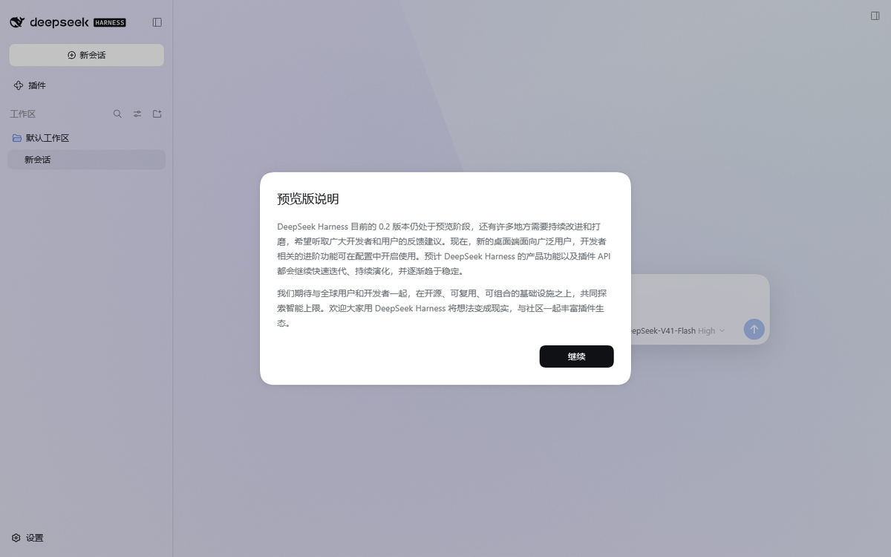
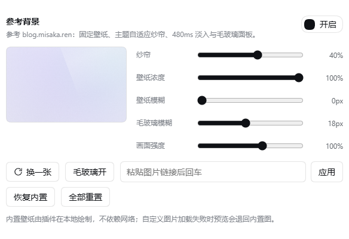

# dsh-misaka-background

一个 [DeepSeek Harness](https://github.com/deepseek-ai/deepseek-harness) 的 Web GUI 客户端插件，
复刻 **[blog.misaka.ren](https://blog.misaka.ren)** 的背景效果：整屏固定壁纸、主题自适应可读性纱帘、
480ms 淡入，以及只给「浮在壁纸上的卡片」用的毛玻璃。



它往 **设置 → 通用** 加的设置行：



> 独立复刻：效果是从该站公开 CSS **实测**出来的，没有复制博客或其它插件的代码。

## 复刻了什么

| 层 | 行为（实测自原站） |
| --- | --- |
| 壁纸 | `position: fixed; inset: 0`、`background-size: cover`、不重复；低于 1024px 取景 `76% 38%`，达到 `64rem`(1024px) 起改 `50% 0%` |
| 淡入 | 只有 opacity，`480ms cubic-bezier(.22, 1, .36, 1)`，以图片解码完成为门控。**关闸是瞬时的**（不带过渡），一个真正绘制过的帧之后才开闸，所以每次换图都是真的 `0 → 1` 动画 —— 见下面「淡入机制」。`prefers-reduced-motion` 下取消 |
| 纱帘 | 深色 `rgb(13 15 22 / α)`、浅色 `rgb(247 248 252 / α)`，`α = 0.3 + overlay/100`（原站 `backgroundOverlay: 40` ⇒ **0.7**），α 下限 0.3 不可突破 |
| 毛玻璃 | 输入卡、消息气泡、代码块、工具 IO 卡、技能指令卡加半透明填充 + `backdrop-filter`。弹窗、设置界面、菜单、Tooltip、Toast 保持官方不透明 —— 它们是阅读面 |
| 卸载 | 每个 DOM 节点、内联属性和注入的规则在 dispose 时都会撤回，关掉插件即恢复官方原样 |

默认壁纸是**运行时在 canvas 上画出来的**（取自原站配色：靛蓝 `#5041db`、紫罗兰 `#9a8bff`、
薄荷 `#57d9cb` 压在 `#f7f8fc` 上）：不打包任何图片素材、不请求网络，换个整数种子就能重画一张。

## 安装

```sh
dsh plugin --profile desktop add /path/to/dsh-misaka-background
```

**然后重启应用**（插件名册在宿主启动时组装一次）。在 harness 源码 checkout 里用
`pnpm dsh plugin --profile desktop add <path>`。卸载：

```sh
dsh plugin --profile desktop remove dsh-misaka-background
```

## 使用

**设置 → 通用 → 参考背景**（就在「外观」附近）。

| 控件 | 含义 |
| --- | --- |
| 开启 / 关闭 | 整体生效或撤回 |
| 纱帘 | 0–70%，即纱帘 α 0.30–1.00。调低让画面透出来，调高保文字对比度 |
| 壁纸浓度 | 壁纸层不透明度 0–100% |
| 壁纸模糊 | 作用于壁纸本身，0–60px（图层会相应放大以遮住模糊边缘） |
| 毛玻璃模糊 | 毛玻璃面上的 `backdrop-filter` 半径，0–40px |
| 画面强度 | 内置壁纸的水彩强度 0–160%（用了自定义图时忽略） |
| 换一张 | 重画下一张内置壁纸（种子 +1）。设了自定义图时置灰 |
| 毛玻璃 | 独立开关毛玻璃填充 |
| 图片地址 + 应用 | 粘贴图片链接后回车或点「应用」，即换成该图 |
| 恢复内置 | 清掉自定义图，回到内置壁纸 |
| 全部重置 | 清掉你的改动，让配置值（或出厂默认）重新生效 |

改完**立即生效，不需要重启**。设置只把**你确实改过的字段**存进 localStorage
（键名 `dsh-misaka-background:settings`），所以改一个滑块不会把配置好的 URL 冲掉。

## 也可以用插件配置（可选）

如果你希望壁纸跟着 profile 走、而不是跟着某个浏览器走：

**① 插件目录里的 `config.json`**（可复制 `config.example.json` 改名）：

```json
{ "imageUrl": "https://example.com/art.png", "overlay": 30 }
```

**② 插件行的 `config:`**（编辑 profile 的补丁层，例如
`~/.dsh/profiles/desktop/cordis.patch.yml`，**覆盖 ①**）：

```yaml
- id: dsh-misaka-background
  name: "dsh-misaka-background"
  config:
    imageUrl: "https://example.com/art.png"
    overlay: 30
```

生效顺序（后者覆盖前者）：**出厂默认 < `config.json` < 插件行 `config` < 设置行里你改过的项**。
「全部重置」只清最后一层。

可用键：`enabled`、`imageUrl`、`overlay`(0–70)、`wallpaperOpacity`(0–100)、`wallpaperBlur`(0–60)、
`glass`、`glassBlur`(0–40)、`artSeed`(1–99)、`artIntensity`(0–160)。未知键忽略、超范围夹取、
没写的键沿用下一层。host half 把解析结果发布在同源的
`GET /dsh-misaka-background/config.json`（只读、只答 GET/HEAD、拒绝跨站请求、不发 CORS 头），
客户端启动时取一次。**这两种方式改完都要重启应用。**

## 淡入机制

淡入是这个插件里最容易「看起来对、其实错」的部分，值得说清楚。

CSS 过渡只有在浏览器**已经绘制过**起始状态时才会动画。由此有两种失败模式，都在 Chromium 里复现过：

1. 关闸和开闸在同一个任务（甚至同一帧）里完成 → 没有起始值可过渡，壁纸直接跳变。
2. 带着过渡去关闸、隔两帧再开闸 → 那个 `1 → 0` 的过渡刚开始就被打断，opacity 根本没接近 0，
   肉眼看到的淡入几乎不存在。

所以插件按原站的做法来：

- **瞬时关闸**：`setSource` 同时打上 `data-instant="true"`（即 `transition: none`）和
  `data-ready="false"`，图层立刻就是 opacity 0。
- **等「位图就绪 + 绘制过一帧」再显现**：可见元素的 `load`/`error` 决定「就绪」（解码失败也算就绪，
  坏链接不会让壁纸永远不可见），随后 `afterPaintedFrame` 等两次 `requestAnimationFrame`，
  保证中间发生过一次渲染更新（因此合成过一次关着闸的画面）。显现时清掉 `data-instant`、
  置 `data-ready="true"`，于是 `0 → 1` 从真正的 0 开始。
- **先预载再换图**：非 `data:` 来源先在离屏 `Image` 上解码，可见元素永远不会停在旧帧上。
- **给等待设上限**：远端请求被接受却一直不回包时，10 秒后放弃并重新显示已经画在屏幕上的那张。

因此换一次图 = 短暂隐藏 → 480ms 淡入，与原站一致（它的闸门本身也没有过渡）。

## 仓库结构

```
lib/client.js        客户端 bundle：整个效果（手写，无构建步骤）
lib/index.js         host half：解析配置 + 一条只读路由
cordis.patch.yml     往 web 插件名册插入这一行
config.example.json  可选的文件配置示例；复制成 config.json 使用
docs/                实测规格、验证记录、截图
.dev/                测试：jsdom 套件 + 真实 Chromium 探针
.github/workflows/   CI：语法检查 + 不需要浏览器的套件
```

README 里所有数值的出处是 [`docs/blog-visual-spec.md`](docs/blog-visual-spec.md)：每一条都带 URL 和
原文 CSS 规则，查不到的项就写「未找到」，不猜。

## 开发与验证

```sh
cd .dev
npm install        # jsdom + puppeteer-core（插件本身没有依赖）
npm test           # 两个不需要浏览器的套件（CI 跑这个）
npm run test:all   # 全部，带产物哈希守卫
```

浏览器类探针需要本地 Chrome，可用 `CHROME_PATH` 指定。完整的测试清单、两个容易踩的坑
（`prefers-reduced-motion` 会从宿主系统继承；「刷页换图」与「页内换图」不是同一条路径），
以及两轮对抗性审查找出的 11 个缺陷与修法，都在 [`docs/verification.md`](docs/verification.md)。

## 已知限制

- 毛玻璃选择器依赖宿主 CSS module 的后缀（`_bubble`、`[data-composer-card]`、`.md-code-block`）。
  宿主改类名会让毛玻璃静默失效，但壁纸、纱帘、淡入不受影响。`_bubble` 与
  `Tooltip.module.css` 同名，所以额外用 `role` 排除、并单独成块：将来真撞名，代价只是气泡失去毛玻璃，
  不会牵连另外四个面。
- 输入卡的 `backdrop-filter` 挂在 `::before` 伪元素上。Chromium 会把任何带 `backdrop-filter`
  的元素变成 Backdrop Root，而输入卡的选择器菜单是它的绝对定位子元素 —— 挂在卡片本身的话，
  菜单只会采样卡片自己的画面。
- 销毁时只还原「当前值仍等于本插件写入值」的属性；宿主或别的插件在壁纸生效期间改过某个私有 token，
  那个新值会被保留。两个宿主也拥有的 token（`--dsw-alias-bg-base`、`--dsw-specific-sidebar-fill`）
  是刻意的例外：值比较分不清「我们写的」和「别人写了同样的字符串」，所以无条件还原为插件之前的快照。
- 被接受却永不回包的远端来源，10 秒后放弃并显示上一张；URL 会保留，方便你改。
- 同一时间只支持一个壁纸插件。
- 设置存在 `localStorage`（属于浏览器 profile），不写 profile 的设置文档；除此之外插件不落盘。

## 许可

MIT，见 [LICENSE](LICENSE)。

插件**不打包**原站的插画：默认壁纸是运行时在 canvas 上按原站配色生成的。这里复刻的是视觉处理方式，
不是分发素材；`docs/blog-visual-spec.md` 记录了它所依据的实测值。
